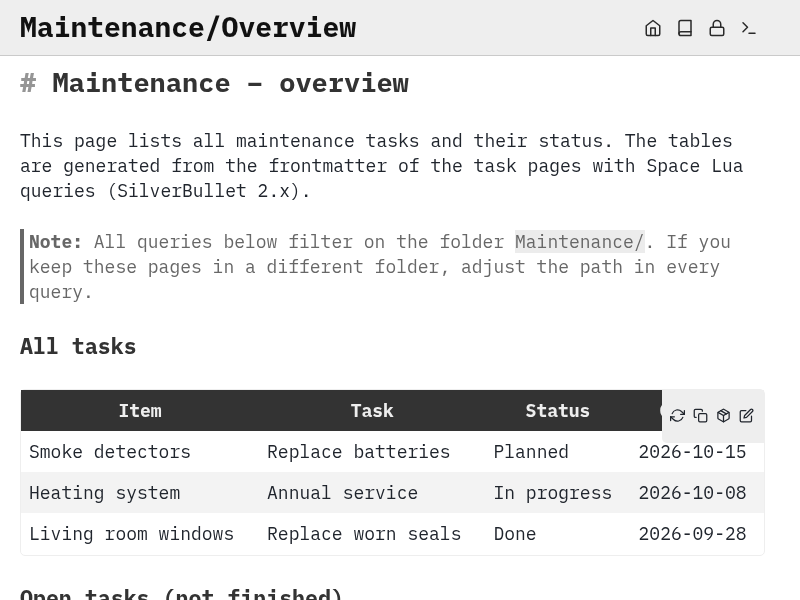
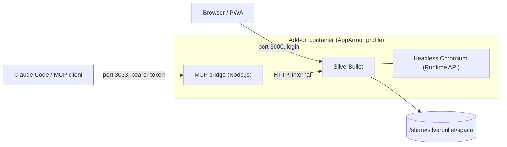

# SilverBullet for Home Assistant

[](https://github.com/TigBay/ha-addons/actions/workflows/lint.yml)
[](https://github.com/TigBay/ha-addons/actions/workflows/build.yml)

[](https://my.home-assistant.io/redirect/supervisor_add_addon_repository/?repository_url=https%3A%2F%2Fgithub.com%2FTigBay%2Fha-addons)

> **A self-hosted Markdown note-taking system as a Home Assistant add-on.**
> All data stays local as plain-text Markdown files — no cloud, no vendor lock-in.

> **Unofficial:** This is a community add-on. It is not affiliated with the SilverBullet project and is neither
> supported nor endorsed by it. The add-on itself is licensed under the MIT license (see below), the bundled
> software under its own licenses.



*The overview page of the [home maintenance example](examples/home-maintenance/) in SilverBullet 2.12.1. The
screenshot was taken with the headless Chromium of the Runtime API in a local Docker container, not on a Home
Assistant system.*

---

## Add-ons in this repository

| Add-on | Status | What it does |
|---|---|---|
| [**SilverBullet**](silverbullet/DOCS.md) | published, tested on Home Assistant | Markdown note-taking system with a web interface and an MCP bridge |
| [**Obsidian LiveSync Server**](obsidian-couchdb/DOCS.md) | draft, local Docker only | CouchDB as a sync backend for Obsidian Self-hosted LiveSync |
| [**Obsidian MCP Server**](obsidian-mcp/DOCS.md) | draft, local Docker only | Reads and writes an end-to-end encrypted Obsidian vault over MCP, with its own OAuth 2.1 provider |

The two Obsidian add-ons are a different answer to the same question as
SilverBullet: notes on your own hardware, reachable from the phone and from an
AI assistant, without the laptop having to be on. They are **drafts**: built
and exercised in local Docker, not yet installed on Home Assistant hardware,
and without a published image — the Supervisor builds them from the Dockerfile.
They are not in the store listing yet.

The two approaches differ where it matters:

| | SilverBullet | Obsidian add-ons |
|---|---|---|
| Editing on the phone | browser, no app needed | Obsidian app, needs HTTPS |
| Database views, Kanban | Space Lua queries | native Bases views, including a Kanban board |
| AI access | MCP bridge, bearer token only | MCP with OAuth 2.1, so claude.ai can connect |
| Memory footprint | ~345 MB idle, up to 715 MB while indexing | ~206 MB idle, ~214 MB while indexing (two containers) |
| Moving parts | one add-on | two add-ons plus a plugin, with version coupling |

---

## Why SilverBullet instead of Notion?

| | SilverBullet | Notion |
|---|---|---|
| **Data ownership** | Local Markdown files | Cloud only |
| **Offline** | Fully offline capable | Limited |
| **Format** | Standard Markdown | Proprietary |
| **AI integration** | MCP (local, your token) | Notion AI (cloud) |
| **Cost** | Free (open source) | Freemium |
| **Backup** | Git, Home Assistant backup, rsync | Export required |

## Features

- Runs directly on your Home Assistant server
- Web interface reachable at `http://<ha-ip>:3000`
- Mobile friendly (progressive web app)
- Data under `/share/silverbullet/space` as a normal file system
- Optional MCP bridge for Claude Code / Claude app
- Authentication enforced (no open operation possible)
- AppArmor security profile
- Health check and watchdog integration
- Options translated into German and English
- `amd64` and `aarch64` (the aarch64 variant is built by CI but not tested on real hardware)
- Lint and build pipeline with GitHub Actions

## Requirements

- Home Assistant OS or Home Assistant Supervised
- Architecture: `amd64` or `aarch64`
- At least 512 MB of free RAM (about 340 MB at idle in the test, including headless Chromium for the Runtime API)
- Port 3000 free (changeable under **Network** in the add-on settings)

## Installation

> In recent Home Assistant versions, add-ons are called "apps". Menu names can differ depending on the version.

### Through the add-on store (recommended)

1. Click the badge above or go to **Settings → Add-ons → Add-on Store**
2. Click **⋮** (three dots) → **Repositories**
3. Add: `https://github.com/TigBay/ha-addons`
4. Search for "SilverBullet" and click **Install**
5. Configure `sb_user` (see below) and start the add-on

### Without Home Assistant

The image is built for the Home Assistant Supervisor and reads its options from `/data/options.json`.
How to start it locally with Docker anyway is described in the [add-on documentation](silverbullet/DOCS.md#test-locally-without-home-assistant).
For plain SilverBullet without Home Assistant, the [official image](https://silverbullet.md) is the better choice.

## Configuration

| Option | Type | Default | Description |
|--------|------|---------|-------------|
| `sb_user` | `str` | `admin:changeme` | Username and password (format: `user:password`) |
| `space_path` | `str` | `/share/silverbullet/space` | Path to the Markdown space |
| `enable_mcp` | `bool` | `false` | Enable the MCP bridge (port 3033, must also be mapped under **Network**) |
| `mcp_token` | `password?` | *(empty)* | Bearer token for MCP (empty = generated automatically, see below) |
| `additional_args` | `str?` | *(empty)* | Additional SilverBullet start arguments |

> **Important:** Change the default password `changeme` right after the installation!

## Data path and backup

### Data path

All Markdown files live under `/share/silverbullet/space`. This folder is reachable through the Samba or SSH add-on.

### Backup strategy

| What | How | Automatic? |
|------|-----|------------|
| Add-on configuration (`/data`) | Home Assistant backup (partial or full) | ✅ Yes |
| Markdown space (`/share/...`) | Home Assistant full backup | ✅ Yes |
| Markdown space (external) | Your own solution, e.g. Git or rsync | 🔲 Manual |

> **Recommendation:** Create regular **full** Home Assistant backups. The space under `/share` is only included in full backups, not in partial backups.


## MCP integration (AI access)

The optional MCP bridge allows AI assistants such as Claude to work directly with your SilverBullet space — read, create, edit and search pages.

### Activation

1. Install the plug **[silverbullet-ai](https://ai.silverbullet.md/)** in the SilverBullet space, either through the
   Library Manager or manually. Both ways are described in the
   [add-on documentation](silverbullet/DOCS.md#install-the-silverbullet-ai-plug).
   Without the plug the bridge exits shortly after the start (hint in the add-on log).
2. Set in the add-on configuration:

   ```yaml
   enable_mcp: true
   mcp_token: "your-long-secure-token"
   ```

3. Under **Network**, enter a port for `3033/tcp` (e.g. `3033`). The port is disabled by default.
4. Restart the add-on.

> **Tip:** Set `mcp_token` yourself. An automatically generated token ends up in `/data/mcp_token.txt` in the add-on data directory, which is visible neither through the Samba nor through the SSH add-on.

### Connect Claude Code

```bash
claude mcp add --transport http silverbullet http://<ha-ip>:3033/mcp \
  --header "Authorization: Bearer <your-mcp-token>"
```

### Access on the go

Use a VPN such as Tailscale: Claude Code then reaches the endpoint through the Tailscale address of your
Home Assistant server, without opening port 3033 to the internet.

Connectors in the Claude app or on claude.ai, on the other hand, are called from the cloud and need a
publicly reachable HTTPS address. That would mean exposing the MCP endpoint to the internet. This add-on
advises against it. If you do it anyway, only with a long, random `mcp_token`.

### Available MCP tools

Which tools (read, create, edit, search pages …) are available is determined by the plug
`silverbullet-ai` and the bridge [`silverbullet-ai-mcp`](https://www.npmjs.com/package/silverbullet-ai-mcp),
not by this add-on. Details are in the [silverbullet-ai documentation](https://ai.silverbullet.md/).
In the test, `tools/list` returned 11 tools (plug 0.9.3).

## Technical implementation



- **Multi-stage build:** The static SilverBullet binary comes from the official upstream image
  (`ghcr.io/silverbulletmd/silverbullet`) and is copied into the Home Assistant base image
  (`ghcr.io/home-assistant/base:3.23`, Alpine). So the add-on needs no separate runtime for SilverBullet,
  only Chromium (Runtime API) and Node.js (MCP bridge).
- **Base image in the Dockerfile:** The build parameters are the default value of `ARG BUILD_FROM` in the
  `Dockerfile`. The `build.yaml` that the Supervisor reports as deprecated is gone; the multi-arch image
  covers both architectures.
- **bashio and Supervisor options:** `run.sh` reads the options with `bashio::config` and falls back to
  `/data/options.json` without a Supervisor. That allows local Docker tests without Home Assistant.
- **Authentication enforced:** Without `username:password` in `sb_user` the add-on does not start.
  An internal token for the bridge is generated anew on every start and never logged.
- **Clean shutdown:** A `SIGTERM` handler stops the MCP bridge first, then SilverBullet. The stop timeout in
  `config.yaml` is 20 seconds (default 10) so that Chromium and SilverBullet have time to exit before the
  Supervisor sends `SIGKILL`.
- **AppArmor profile:** Access only to the required paths, write access to the shared folder only under
  `/share/silverbullet` (plus `/data` and temporary paths). `privileged` is empty (`[]`), the add-on runs
  without extra capabilities.
- **Optional MCP bridge:** `silverbullet-ai-mcp` (Node.js) only runs with `enable_mcp: true`. The add-on
  detects an exited bridge, for example with a missing plug, and writes an error message to the log.
- **Multi-arch CI with GHCR:** GitHub Actions builds `amd64` and `aarch64` (via QEMU) separately, pushes the
  tags `<version>-<arch>` and combines them into a multi-arch manifest `<version>`. If the version already
  exists in GHCR, the build is skipped so that a published tag is not overwritten silently.

## Tested

As of 2026-11-01, Home Assistant OS with Core 2026.10.4 on amd64. The test covered the published store version
(slug `<hash>_silverbullet`, image `ghcr.io/tigbay/ha-addons-silverbullet:2026.10.0` pulled from GHCR, not built
locally) after it replaced an earlier locally built copy of the same add-on.

| Check | Result |
|-------|--------|
| `/.instance` answers with 200 (SilverBullet 2.12.1) | ✅ |
| Login protection: 401 without login, cookie login works | ✅ |
| Write, read and delete a page (PUT/GET/DELETE) | ✅ |
| `.silverbullet.auth.json` with permissions 600 | ✅ |
| Runtime API with Chromium (`{"result":"Hello"}`) | ✅ |
| MCP with the plug: 401 without token, `initialize`, `tools/list` (11 tools) | ✅ |
| Stop with "shut down cleanly", restart | ✅ |
| AppArmor profile installed by the Supervisor (`ha apps info` reports `apparmor: profile`) | ✅, denials not checked |
| No token or password in the add-on log | ✅ (0 matches for each) |

Measurements: stop 4.1 s, start until `/.instance` answers 5.7 s, about 345 MB RAM and 2.5 % CPU at idle (with
Chromium). Right after the first start the add-on indexes the space, which temporarily used about 715 MB and 30 % CPU.

The four Space Lua queries of the example ([`examples/home-maintenance`](examples/home-maintenance/)) were run
on 2026-11-01 through the Runtime API of this instance against the three example pages. For the test the pages were
stored under `HA-Test/maintenance/` and the folder prefix in the queries was changed accordingly. All four queries
returned the expected rows, and the test pages were deleted afterwards.

**Not tested:**

- The web interface in a browser on the Home Assistant system. It was only checked with `curl` there. The
  screenshot above comes from a local container.
- `aarch64` on real hardware. CI builds the image, but it was never started.
- The watchdog on a real crash.
- CPU load over a longer period.

## Known limitations

- The password is stored in plain text in the add-on options (`sb_user`). That is usual for Home Assistant add-ons.
- The MCP bridge is meant for the local network or a tunnel (e.g. Tailscale), not for the open internet.
- The bridge does not send an `Mcp-Session-Id` header (observation from the test, behavior of `silverbullet-ai-mcp`).
- `list_pages` with `prefix` only returned the page `index` in the test. The behavior is not in this add-on,
  the cause was not investigated.
- The AppArmor profile only allows space paths under `/share/silverbullet/`.

## Security

> **SilverBullet never runs without authentication.**

### Implemented measures

- `sb_user` is mandatory — a start without a password is rejected
- The default password `changeme` triggers a warning in the log
- The MCP token is not written to the logs
- Automatically generated tokens are stored under `/data/mcp_token.txt` with permission `600`
- The AppArmor profile restricts container access
- The MCP bridge only runs with `enable_mcp: true`, its port is not mapped by default
- Health check and watchdog use the authentication-free `/.instance` endpoint
- Stopping within the Supervisor timeout (20 s) with a clean shutdown

### Security recommendations

- Change the default password immediately
- Use a strong MCP token (at least 32 characters)
- Do not expose port 3000 to the internet
- Use Tailscale or a VPN for external access
- **Prompt injection risk:** If Claude has access to notes, malicious content in Markdown files can act as a prompt injection vector. Do not store untrusted content in a space that Claude can access.

## Troubleshooting

| Problem | Solution |
|---------|----------|
| The add-on does not start | Check the logs: Settings → Add-ons → SilverBullet → Log |
| Port 3000 in use | Change the port under **Network** in the add-on settings |
| Login fails | Check the `sb_user` format: `username:password` |
| MCP does not respond | Check `enable_mcp: true`, the port mapping under **Network** and the plug `silverbullet-ai` |
| Log: "MCP bridge exited" | The plug `silverbullet-ai` is missing in the space |
| MCP token unknown | Set `mcp_token` yourself in the configuration and restart |
| Space empty after restart | Check that `space_path` points to `/share/silverbullet/space` |
| High RAM usage | The Runtime API starts a headless Chromium; the MCP bridge additionally needs Node.js |
| A change to the AppArmor profile has no effect | The profile is only loaded on installation: uninstall and install again (see the [documentation](silverbullet/DOCS.md)) |

## Developer documentation

### Local build

```bash
# Clone the repository
git clone https://github.com/TigBay/ha-addons.git
cd ha-addons

# Build the Dockerfile locally (the base image is the default value of BUILD_FROM)
docker build -t sb-test ./silverbullet/
```

The complete local test run (with `options.json`, authentication check and stop test) is described in the
[add-on documentation](silverbullet/DOCS.md#test-locally-without-home-assistant).

### Lint checks

```bash
# YAML (same rules as in .github/workflows/lint.yml)
pip install yamllint
yamllint --config-data '{extends: default, rules: {line-length: {max: 120}, document-start: disable, truthy: {check-keys: false, allowed-values: ["true", "false"]}}}' \
  repository.yaml silverbullet/config.yaml silverbullet/translations/*.yaml .github/workflows/*.yml

# Shell
shellcheck silverbullet/run.sh

# Dockerfile
docker run --rm -i hadolint/hadolint hadolint --ignore DL3006 --ignore DL3016 --ignore DL3018 --ignore DL3025 - < silverbullet/Dockerfile

# AppArmor profile (syntax)
apparmor_parser -Q -K --skip-cache silverbullet/apparmor.txt

# GitHub Actions workflows
docker run --rm -v "$PWD":/repo -w /repo rhysd/actionlint:latest
```

### Release process

1. Raise the version in `silverbullet/config.yaml` (CalVer: `YYYY.MM.PATCH`)
2. Update `CHANGELOG.md`
3. Commit and push to `main`
4. GitHub Actions builds automatically and pushes to GHCR. A version that is already in GHCR is not
   overwritten. For that, raise the version or start the workflow manually with `force_push`.
5. After a successful build the workflow creates the tag `vX` and a GitHub release from the changelog entry.
6. Set the GHCR package to **Public** (only the first time):
   GitHub → profile → Packages → `ha-addons-silverbullet` → Package settings → Visibility → Public

### Automatic SilverBullet updates

The workflow [`upstream-update.yml`](.github/workflows/upstream-update.yml) checks once a day for a new release of
[`silverbulletmd/silverbullet`](https://github.com/silverbulletmd/silverbullet/releases) (prereleases are ignored).
For a new release it raises the pinned image in the `Dockerfile`, the add-on version (`YYYY.M.PATCH`, a new month starts
at `0`) and the changelog, builds the image and runs [`smoke-test.sh`](.github/scripts/smoke-test.sh). Only if that
passes, it opens a pull request. Nothing is published until you merge it (squash merge recommended). The merge starts
the build workflow, which pushes the image to GHCR and creates the release.

- The smoke test covers start, login protection, write/read/delete and a clean stop on amd64. It does **not** cover the
  MCP bridge, the Runtime API, aarch64 or Home Assistant itself. Read the upstream release notes before merging.
- A closed pull request is not proposed again for the same version.
- Start it manually with **Actions → Update SilverBullet → Run workflow** (optionally with a version).
- Needs the setting *Settings → Actions → General → Allow GitHub Actions to create and approve pull requests*.
- Optional secret `UPSTREAM_PR_TOKEN` (personal access token with write access to contents and pull requests). Without
  it the pull request is created with `GITHUB_TOKEN`, and GitHub then does not start the regular checks (lint, smoke
  test) on it. The smoke test has already run inside the update workflow in that case.

### Repository settings

The build workflow needs no manual secrets. `GITHUB_TOKEN` automatically has `packages:write` permission.

If the workflow does not have `packages:write`:
1. GitHub → repository → Settings → Actions → General
2. Under "Workflow permissions": enable **Read and write permissions**

## Examples

The folder [`examples/home-maintenance/`](examples/home-maintenance/) contains a complete maintenance tracker with:

- 3 sample tasks with frontmatter (all data fictional)
- A dashboard with Space Lua queries for SilverBullet 2.x (open tasks, overdue tasks, statistics)
- Instructions for managing it through Claude MCP

## License

This add-on is licensed under the MIT license, see [LICENSE](LICENSE). It bundles software from other projects
that is licensed under its own terms:

| Component | License |
|-----------|---------|
| [SilverBullet](https://github.com/silverbulletmd/silverbullet) (binary in the image) | MIT |
| [silverbullet-ai](https://github.com/justyns/silverbullet-ai) (plug, installed by you in the space) | AGPL-3.0 |
| [silverbullet-ai-mcp](https://www.npmjs.com/package/silverbullet-ai-mcp) (MCP bridge in the image) | AGPL-3.0-only |
| Home Assistant base image, Chromium, Node.js | their own licenses each |

---

**Created by [TigBay](https://github.com/TigBay)** | [Report issues](https://github.com/TigBay/ha-addons/issues) | [SilverBullet documentation](https://silverbullet.md)
