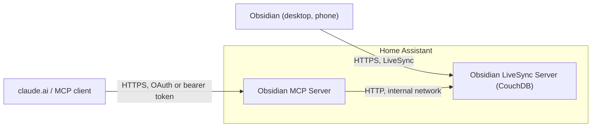

# Obsidian LiveSync add-ons for Home Assistant

[](https://github.com/TigBay/ha-addons/actions/workflows/lint.yml)

[](https://my.home-assistant.io/redirect/supervisor_add_addon_repository/?repository_url=https%3A%2F%2Fgithub.com%2FTigBay%2Fha-addons)

Two Home Assistant add-ons that keep an Obsidian vault on your own server. One
is the CouchDB backend for the [Self-hosted LiveSync](https://github.com/vrtmrz/obsidian-livesync)
plugin, the other is an MCP server that lets an AI assistant such as Claude
read and edit the vault. Both run on the Home Assistant machine, so no laptop
has to stay on.

These are unofficial community add-ons. They are not affiliated with or
endorsed by Obsidian, Self-hosted LiveSync, obsidian-sync-mcp or the Apache
CouchDB project.

## Add-ons

| Add-on | Version | Purpose |
|---|---|---|
| [Obsidian LiveSync Server](obsidian-couchdb/DOCS.md) | 0.2.1 | CouchDB database that LiveSync syncs your devices through |
| [Obsidian MCP Server](obsidian-mcp/DOCS.md) | 0.2.1 | MCP endpoint for the vault, with its own OAuth login so claude.ai can add it as a connector |

The Supervisor builds both add-ons on your machine from their `Dockerfile`.
There are no prebuilt images, so the first installation takes a minute or two.



LiveSync encrypts your notes on each device before uploading them, so CouchDB
only stores encrypted data. The MCP server is different: it needs your
passphrase to read the notes and can therefore decrypt the whole vault. The
[MCP documentation](obsidian-mcp/DOCS.md#3-the-passphrase) explains what that
means for the machine it runs on.

## How your devices connect

Neither add-on accepts plain HTTP from the network. Obsidian on a phone only
connects over HTTPS, and claude.ai needs a public HTTPS address. You have two
options:

- **Tunnel or reverse proxy.** An add-on such as Cloudflare Tunnel connects to
  CouchDB on port 5984 and to the MCP server on port 8787 over the internal
  network and offers HTTPS to the outside. This is the setup I use and have
  tested.
- **Built-in HTTPS.** Turn on the `ssl` option, put a certificate for your
  host name into `/ssl` and publish port 6984 (CouchDB) or 8443 (MCP). This
  has only been tested in local Docker so far.

## Upgrading from 0.1.x

Version 0.2.0 stopped publishing ports 5984 and 8787, because both served
plain HTTP. If one of them still has a host port from an older installation,
the add-on stops at startup and the log names the port. Clear it under
**Network** in the add-on settings and pick one of the options above. The
changelogs of [CouchDB](obsidian-couchdb/CHANGELOG.md) and
[MCP](obsidian-mcp/CHANGELOG.md) have the details.

## Requirements

- Home Assistant OS or Home Assistant Supervised
- `amd64` or `aarch64`. Only `amd64` has been tested on real hardware.
- An HTTPS route from your devices to the add-ons, see above

## Installation

Newer Home Assistant versions call add-ons "apps", so the menu names below
may differ slightly.

1. Click the "Add repository" badge above, or go to **Settings → Add-ons →
   Add-on Store**, open the **⋮** menu, choose **Repositories** and add
   `https://github.com/TigBay/ha-addons`.
2. Install **Obsidian LiveSync Server** and follow its
   [setup guide](obsidian-couchdb/DOCS.md#getting-started).
3. If you want AI access, install **Obsidian MCP Server** and follow its
   [setup guide](obsidian-mcp/DOCS.md#getting-started).

## Testing

I run both add-ons on a Dell Wyse (amd64) with Home Assistant OS, behind
Cloudflare Tunnel and Cloudflare Access. Tested there:

- installation, updates, rebuilds and host reboots keep the data and settings
- partial backup and restore of both add-ons
- LiveSync on an iPhone through the tunnel, with the Cloudflare Access service
  token sent as custom headers
- the claude.ai connector over OAuth: reading, writing, searching, renaming
  and deleting notes
- the startup check stops an add-on while 5984 or 8787 is published, and the
  watchdog works with both ports unpublished

Not tested on real hardware yet: the built-in HTTPS listeners on 6984 and 8443
(tested in local Docker) and `aarch64`.

## Security

- Neither add-on starts without a password (CouchDB) or a token (MCP).
- Passwords, the MCP token and the LiveSync passphrase are stored in plain text
  in the add-on options, and therefore in every Home Assistant backup. Make
  sure your backups are encrypted.
- `write_folders` limits the folders the MCP server may change. Empty means
  the whole vault.
- An AI assistant reads every note it opens, including text written to steer
  it (prompt injection), for example in web clippings. If your vault holds
  content from sources you do not trust, keep write access narrow with
  `write_folders`.
- AppArmor is off for both add-ons until a profile has been tested on real
  hardware.

Each add-on's documentation lists more under *Known limitations*.

## Development

```bash
git clone https://github.com/TigBay/ha-addons.git
cd ha-addons

# Build locally
docker build -t obsidian-couchdb-test ./obsidian-couchdb/
docker build -t obsidian-mcp-test ./obsidian-mcp/

# YAML (same rules as .github/workflows/lint.yml)
pip install yamllint
yamllint --config-data '{extends: default, rules: {line-length: {max: 120}, document-start: disable, truthy: {check-keys: false, allowed-values: ["true", "false"]}}}' \
  repository.yaml obsidian-*/config.yaml obsidian-*/translations/*.yaml .github/*.yml .github/workflows/*.yml

# Shell scripts
shellcheck obsidian-*/run.sh

# Dockerfiles (same ignores as the lint workflow)
for d in obsidian-couchdb obsidian-mcp; do
  docker run --rm -i hadolint/hadolint hadolint \
    --ignore DL3006 --ignore DL3008 --ignore DL3016 --ignore DL3018 --ignore DL3025 - < "$d/Dockerfile"
done

# GitHub Actions workflows
docker run --rm -v "$PWD":/repo -w /repo rhysd/actionlint:latest
```

### Releasing a new version

1. Raise `version` in `<add-on>/config.yaml` (SemVer). Home Assistant only
   rebuilds an add-on when this number changes.
2. Add an entry to `<add-on>/CHANGELOG.md`.
3. Open a pull request against `main`. The lint workflow has to pass.
4. After the merge, Home Assistant offers the update and builds it on the
   device.

Dependabot opens pull requests for new base images. They need steps 1 and 2
before they can be merged.

## License

The add-ons are MIT licensed, see [LICENSE](LICENSE). They are built on or
work with these projects, each under its own license:

| Component | License |
|-----------|---------|
| [Apache CouchDB](https://github.com/apache/couchdb) (base image of the LiveSync Server) | Apache-2.0 |
| [obsidian-sync-mcp](https://github.com/es617/obsidian-sync-mcp) (base image of the MCP Server) | MIT |
| [bashio](https://github.com/hassio-addons/bashio) (in both images) | MIT |
| [Self-hosted LiveSync](https://github.com/vrtmrz/obsidian-livesync) (Obsidian plugin, installed by you) | MIT |

Bugs and questions: [GitHub issues](https://github.com/TigBay/ha-addons/issues).
