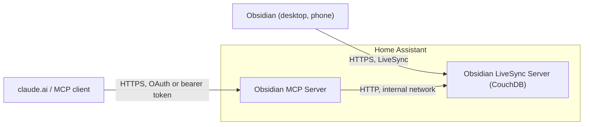

# Obsidian LiveSync add-ons for Home Assistant

[](https://github.com/TigBay/ha-addons/actions/workflows/lint.yml)

[](https://my.home-assistant.io/redirect/supervisor_add_addon_repository/?repository_url=https%3A%2F%2Fgithub.com%2FTigBay%2Fha-addons)

> **Your Obsidian vault on your own hardware.** Sync between your devices with
> Self-hosted LiveSync, end-to-end encrypted, and give an AI assistant such as
> Claude access to it over MCP — without a laptop that has to stay on.

> **Unofficial:** community add-ons, not affiliated with Obsidian, Self-hosted
> LiveSync, obsidian-sync-mcp, the CouchDB project or the Apache Software
> Foundation, and neither supported nor endorsed by them.

---

## Add-ons in this repository

| Add-on | Version | What it does |
|---|---|---|
| [**Obsidian LiveSync Server**](obsidian-couchdb/DOCS.md) | 0.2.1 | CouchDB as the sync backend for the Obsidian plugin Self-hosted LiveSync |
| [**Obsidian MCP Server**](obsidian-mcp/DOCS.md) | 0.2.1 | Reads and writes the end-to-end encrypted vault over MCP, with its own OAuth 2.1 provider, so claude.ai can connect |

Both add-ons are **built on your device** by the Supervisor from their
`Dockerfile`; there is no prebuilt image. The first installation therefore
takes a little longer.



The notes are encrypted on the device before they reach CouchDB. The MCP
server needs the passphrase to read them, so it can decrypt the vault — see
the [MCP documentation](obsidian-mcp/DOCS.md#3-the-passphrase) for what that
means for the host.

## Breaking change in 0.2.0

Neither add-on serves plain HTTP to the network any more. Ports 5984 (CouchDB)
and 8787 (MCP) are no longer published, and each add-on **refuses to start**
while one of them still has a host port — including one kept from an earlier
version. Clear the port under **Network** in the add-on settings.

To reach the add-ons from other devices, either

- turn on the `ssl` option and publish the HTTPS port (6984 for CouchDB, 8443
  for MCP), with a certificate under `/ssl` that is valid for the host name you
  connect to, or
- put a tunnel or proxy add-on in front of them, for example Cloudflare Tunnel,
  which reaches them over the internal network.

Details are in the changelogs of [CouchDB](obsidian-couchdb/CHANGELOG.md) and
[MCP](obsidian-mcp/CHANGELOG.md).

## Requirements

- Home Assistant OS or Home Assistant Supervised
- Architecture `amd64` or `aarch64` (aarch64 has never run on real hardware)
- An HTTPS route to the add-ons from your devices: Obsidian on the phone only
  connects over HTTPS, and claude.ai needs a public HTTPS address

## Installation

> In recent Home Assistant versions, add-ons are called "apps". Menu names can differ depending on the version.

1. Click the badge above or go to **Settings → Add-ons → Add-on Store**
2. Click **⋮** (three dots) → **Repositories**
3. Add: `https://github.com/TigBay/ha-addons`
4. Install **Obsidian LiveSync Server** first, then **Obsidian MCP Server** if you want AI access
5. Follow the documentation of each add-on:
   [LiveSync Server](obsidian-couchdb/DOCS.md#getting-started),
   [MCP Server](obsidian-mcp/DOCS.md#getting-started)

## Tested

On Home Assistant OS, amd64 (Dell Wyse), with version **0.1.x**:

| Check | Result |
|---|---|
| Installation, add-on update, rebuild, host reboot | data kept, mandatory login and CORS settings kept |
| Partial backup and restore of both add-ons | database restored, MCP index rebuilt |
| MCP server reaches CouchDB by the internal host name `local-obsidian-couchdb` | ✅ |
| Cloudflare Tunnel (remote managed) to `local-obsidian-couchdb:5984` and `local-obsidian-mcp:8787` | ✅ |
| Obsidian on an iPhone with LiveSync through the tunnel and Cloudflare Access (service token in custom headers) | download and upload ✅ |
| claude.ai connector over OAuth (registration, password page, token) | ✅ |

On the same machine with version **0.2.x**:

| Check | Result |
|---|---|
| Port check over `hassio_api` with 5984 and 8787 published | both add-ons stop with a message naming the host port, and start once the port is cleared ✅ |
| Watchdog with 5984 and 8787 unpublished | probes the container port, no false restarts ✅ |
| *Open Web UI* link on 6984 | shown even without a host port, pointing to port `None`; removed in 0.2.1 |
| MCP update 0.2.0 → 0.2.1 (obsidian-sync-mcp v0.11.0) | index rebuilt (535 notes), OAuth tokens kept, Cloudflare Tunnel unchanged ✅ |
| claude.ai connector after the update: write, case-only rename, read, search, delete | note kept on `Foo.md` → `foo.md` ✅ |
| HTTPS listener on 6984 and 8443 with a certificate from `/ssl` | tested in local Docker only |

## Security

- Both add-ons refuse to start without a password (CouchDB) or bearer token (MCP).
- No plain-HTTP port on the network, see above.
- Passwords, the token and the LiveSync passphrase are stored in clear text in
  the add-on options and therefore in every Home Assistant backup. **Protect
  your backups with a password.**
- `write_folders` limits which folders the MCP server may change. Empty means
  the whole vault.
- **Prompt injection:** an AI assistant with access to the vault reads every
  note it opens. Do not keep untrusted content where it has write access.
- AppArmor is off for both add-ons until a profile has been tested on real
  hardware.

More in the *Known limitations* sections of both documentations.

## Development

```bash
git clone https://github.com/TigBay/ha-addons.git
cd ha-addons

# Build locally
docker build -t obsidian-couchdb-test ./obsidian-couchdb/
docker build -t obsidian-mcp-test ./obsidian-mcp/

# YAML (same rules as in .github/workflows/lint.yml)
pip install yamllint
yamllint --config-data '{extends: default, rules: {line-length: {max: 120}, document-start: disable, truthy: {check-keys: false, allowed-values: ["true", "false"]}}}' \
  repository.yaml obsidian-*/config.yaml obsidian-*/translations/*.yaml .github/workflows/*.yml

# Shell
shellcheck obsidian-*/run.sh

# Dockerfiles
for d in obsidian-couchdb obsidian-mcp; do
  docker run --rm -i hadolint/hadolint hadolint --ignore DL3006 --ignore DL3008 --ignore DL3018 --ignore DL3025 - < "$d/Dockerfile"
done

# GitHub Actions workflows
docker run --rm -v "$PWD":/repo -w /repo rhysd/actionlint:latest
```

### Release process

1. Raise the version in `<add-on>/config.yaml` (SemVer)
2. Update `<add-on>/CHANGELOG.md`
3. Open a pull request against `main`; the lint workflow must pass
4. After the merge, Home Assistant offers the update and builds it on the device

## License

These add-ons are licensed under the MIT license, see [LICENSE](LICENSE). They
bundle or depend on software from other projects under their own terms:

| Component | License |
|-----------|---------|
| [Apache CouchDB](https://github.com/apache/couchdb) (base image of the LiveSync Server) | Apache-2.0 |
| [obsidian-sync-mcp](https://github.com/es617/obsidian-sync-mcp) (base image of the MCP Server) | MIT |
| [bashio](https://github.com/hassio-addons/bashio) (in both images) | MIT |
| [Self-hosted LiveSync](https://github.com/vrtmrz/obsidian-livesync) (Obsidian plugin, installed by you) | MIT |

---

**Created by [TigBay](https://github.com/TigBay)** | [Report issues](https://github.com/TigBay/ha-addons/issues)
